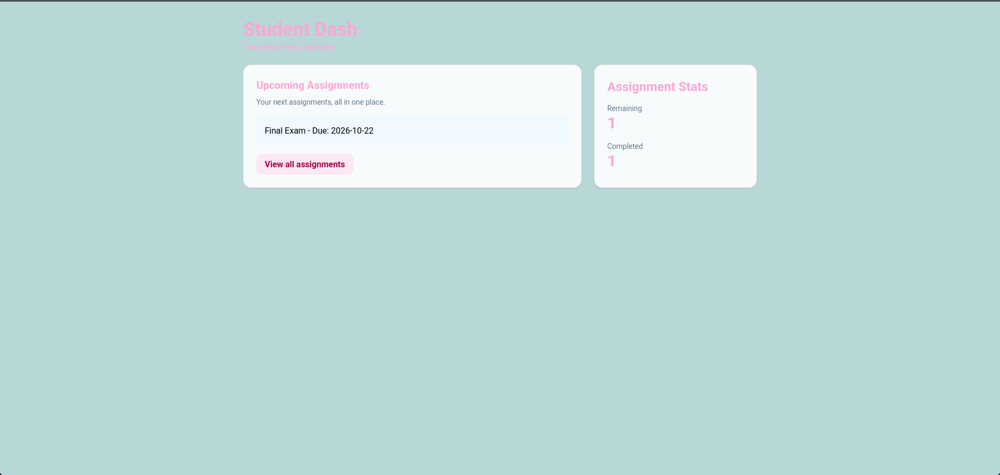
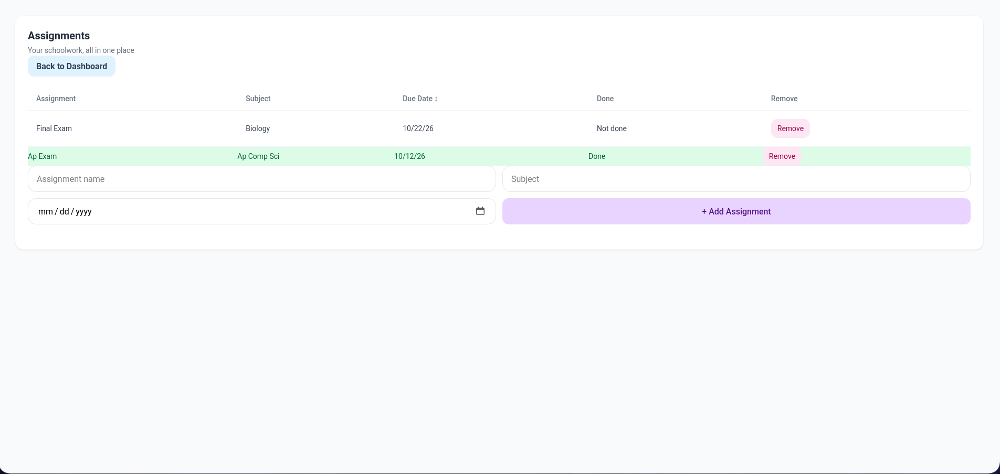

# Student Dash

*A little place to help students like myself keep track of schoolwork!*

## About

Student Dash is a simple assignment organizer designed to help students keep track of their schoolwork with an easy-to-read table and clear due dates.

I built it because I struggled to find an assignment manager that worked for me. Many existing solutions made it difficult to spot urgent assignments or quickly figure out what needed to be done. I wanted to create something simpler, more organized, and less overwhelming.

## How It Works

Users can add, remove, and mark assignments as completed through the assignment manager, accessible from the main dashboard.

Assignments are saved in the browser's local storage, so they remain available when the page is reopened in the same browser. The main dashboard displays the three most urgent incomplete assignments, helping students prioritize their work without feeling overwhelmed.

## Screenshots

### Main Dashboard

### Assignment Manager

## Features

- Add and remove assignments.
- Mark assignments as completed.
- Organize assignments by subject and due date.
- View the three most urgent incomplete assignments on the main dashboard.
- Track